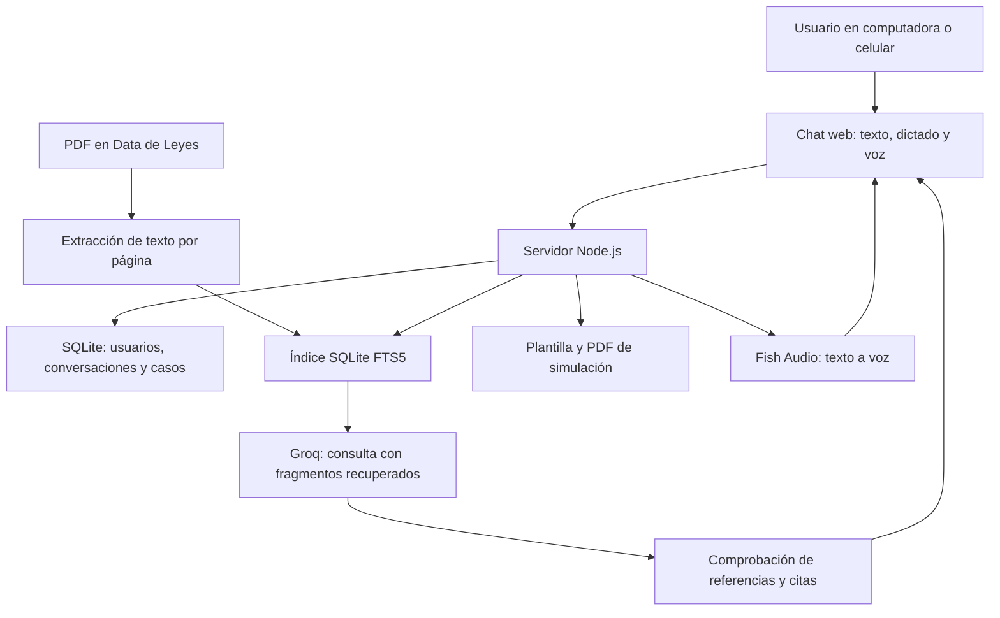

# AbogadoIA · Asistente legal conversacional para Perú

Aplicación web que reúne **conversación, consulta de leyes y preparación de documentos en un mismo chat**. Su enfoque actual es acompañar la preparación de una **demanda inicial de alimentos para niñas, niños y adolescentes**, con información declarada por la persona, revisión de datos y generación de un PDF de simulación.

El usuario puede escribir, dictar o conversar por voz, consultar su biblioteca de PDF y continuar el documento sin abrir otro chat. La interfaz se adapta a computadora y celular.

> **Estado actual: MVP local para datos ficticios.** Los documentos generados llevan la marca **SIMULACIÓN - NO PRESENTAR**. La presentación de demandas al Poder Judicial y el autocompletado con Playwright son propuestas futuras; todavía no están implementados. El avance real de las 40 historias está en [HU_ESTADO.md](mvp/HU_ESTADO.md).

## Contenido

- [Qué hace el chatbot](#qué-hace-el-chatbot)
- [Cómo funciona](#cómo-funciona)
- [Instalar en otra computadora](#instalar-en-otra-computadora)
- [Configurar las claves](#configurar-las-claves)
- [Usarlo por primera vez](#usarlo-por-primera-vez)
- [Biblioteca de leyes y PDF](#biblioteca-de-leyes-y-pdf)
- [Uso desde celular](#uso-desde-celular)
- [Datos y copias de seguridad](#datos-y-copias-de-seguridad)
- [Límites y siguientes etapas](#límites-y-siguientes-etapas)
- [Problemas frecuentes](#problemas-frecuentes)
- [Estructura y comandos](#estructura-y-comandos)

## Qué hace el chatbot

| Función | Comportamiento actual |
|---|---|
| Conversación unificada | Permite consultas generales, preguntas jurídicas y preparación del documento en el mismo hilo. |
| Consulta de leyes con RAG | Busca fragmentos de los PDF locales, los envía a Groq y muestra referencias, citas y página del documento. |
| Seguimiento del asunto | Reconoce algunos seguimientos breves y errores de escritura; conserva hechos declarados y permite cambiar de tema. Su comprensión no es exhaustiva. |
| Demanda de alimentos | Confirma el procedimiento antes de crear el caso y reúne datos de las partes, menores, hechos, necesidades, monto y pruebas declaradas. |
| Confirmación y corrección | Presenta propuestas de datos para confirmar, permite pausar o retomar y exige revisar el resumen antes de descargar. |
| Archivos adjuntos | Guarda anexos ficticios PDF, PNG y JPEG de hasta 5 MB por archivo. Los anexos no se incorporan automáticamente al RAG. |
| Documentos PDF | Genera un borrador de simulación y permite seleccionar versiones del formulario del Poder Judicial como referencia o vista con datos superpuestos. |
| Voz y dictado | Groq transcribe el micrófono; el chat responde y Fish Audio genera la voz configurada. El dictado puede revisarse antes de enviar. |
| Personaje animado | Personaje Rive original con estados de escuchar, pensar, hablar, celebrar, silencio y error. La boca reacciona al audio reproducido. |
| Historial privado | Guarda conversaciones y casos por usuario en SQLite, con contenido sensible cifrado. |
| Guía práctica acotada | Para robo de celular incluye orientación local de Perú con enlaces oficiales y fecha de revisión; no genera una denuncia penal. |

### Recorrido para preparar el documento

1. La persona elige **Preparar una demanda** o lo solicita en el chat.
2. El asistente aclara el asunto y pide confirmar **alimentos para menores** y el uso de datos ficticios.
3. Reúne los datos paso a paso. Puede interpretar varios datos con Groq y propone incorporarlos después de confirmarlos.
4. La persona puede hacer consultas, pausar, retomar, adjuntar archivos y corregir desde **Mi documento**.
5. Al completar los datos, revisa y confirma el resumen.
6. Descarga el PDF de simulación o la versión disponible del formulario. Cualquier cambio de datos o anexos exige confirmar nuevamente.

Los supuestos de personas adultas, pretensiones acumuladas o urgencia quedan fuera del generador actual. Tener otros formularios en la biblioteca no habilita sus procedimientos.

## Cómo funciona



- **Groq** conversa, interpreta datos declarados y responde consultas con los extractos recuperados; también transcribe audio con la configuración predeterminada.
- **RAG** significa recuperar información antes de generar una respuesta. Aquí usa búsquedas de texto en **SQLite FTS5**. No hay embeddings ni base vectorial externa; Groq no lee toda la carpeta de PDF en cada mensaje.
- **Control de respaldo:** las respuestas jurídicas proponen afirmaciones y citas literales. El servidor comprueba su presencia en los extractos y omite afirmaciones que no superen esa comprobación; puede indicar respaldo parcial o insuficiente.
- **SQLite** está integrado mediante `node:sqlite`. No necesitas instalar PostgreSQL ni un servidor de base de datos.
- **PDF** se genera con plantillas y datos declarados; no se confía al modelo la invención de personas, montos o hechos.
- **Respuestas locales:** algunas confirmaciones, validaciones y guías acotadas se resuelven sin llamar a Groq. La interfaz identifica el origen de la respuesta.

**Una cita comprobada no garantiza una interpretación correcta ni vigencia jurídica. No se promete cero alucinaciones.** La explicación técnica ampliada está en [mvp/README.md](mvp/README.md).

## Instalar en otra computadora

### Qué necesitas descargar o tener

| Requisito | Para qué sirve |
|---|---|
| [Git](https://git-scm.com/downloads) | Clonar y actualizar el repositorio. También puedes descargar el ZIP desde GitHub. |
| [Node.js 24 o superior](https://nodejs.org/) con npm | Ejecutar el servidor y las dependencias. Verifica `node --version` y `npm --version`. |
| Navegador actualizado | Abrir la aplicación; para voz también se requiere micrófono y permiso de captura. |
| [Clave de Groq](https://console.groq.com/keys) | Conversación con IA, interpretación y transcripción predeterminada. |
| [Cuenta y clave de Fish Audio](https://fish.audio/app/developers), más un ID de voz | Necesarios para reproducir respuestas con la voz de Fish. |
| Conexión a Internet | Instalar dependencias y usar las API externas. |

`npm ci` instala el lector de PDF, el generador de documentos y el reproductor Rive. La animación ya viene incluida. No necesitas instalar Python, un servidor web adicional, el editor Rive ni Playwright para ejecutar las funciones actuales. Las funciones locales del formulario pueden utilizarse sin claves; la conversación libre y la voz necesitan sus proveedores.

### 1. Clonar e instalar

```bash
git clone https://github.com/Brando-01/Abogado_IA.git
cd Abogado_IA/mvp
npm ci
```

### 2. Crear el archivo de configuración

En una instalación nueva, desde la carpeta `mvp`, ejecuta en **PowerShell**:

```powershell
Copy-Item .env.example .env
```

En **Linux o macOS**:

```bash
cp .env.example .env
```

Si ya tienes `.env`, conserva tus claves; no lo sobrescribas con el ejemplo.

### 3. Configurar y arrancar

Edita `.env` como se explica a continuación y ejecuta:

```bash
npm start
```

Abre **[http://127.0.0.1:4173/](http://127.0.0.1:4173/)**. Para detener el servidor, pulsa `Ctrl+C` en su terminal.

**Ejecuta la aplicación con `npm start`.** Abrir el HTML directamente o usar Live Server no inicia la API, la base de datos ni las funciones de IA.

## Configurar las claves

Ejemplo de `mvp/.env` con espacios para tus propias credenciales:

```dotenv
GROQ_API_KEY=
GROQ_MODEL=openai/gpt-oss-120b
HOST=127.0.0.1
PORT=4173

FISH_AUDIO_API_KEY=
FISH_AUDIO_VOICE_ID=
FISH_AUDIO_MODEL=s2.1-pro-free
VOICE_STT_PROVIDER=groq
GROQ_STT_MODEL=whisper-large-v3-turbo
```

| Variable | Qué debes colocar |
|---|---|
| `GROQ_API_KEY` | Tu clave de Groq, después del signo `=`. |
| `GROQ_MODEL` | Modelo de conversación compatible; el mostrado es el predeterminado del proyecto. |
| `FISH_AUDIO_API_KEY` | Tu clave de API de Fish Audio. |
| `FISH_AUDIO_VOICE_ID` | Identificador de la voz elegida en Fish Audio. |
| `FISH_AUDIO_MODEL` | Modelo de síntesis compatible con tu cuenta y voz. |
| `VOICE_STT_PROVIDER` | `groq` para la transcripción predeterminada. Fish ASR es una opción independiente. |
| `GROQ_STT_MODEL` | Modelo de reconocimiento del micrófono de Groq. |
| `HOST` y `PORT` | Dirección y puerto donde escucha el servidor; por defecto, acceso en esta computadora. |

Escribe cada opción como `NOMBRE=valor`, sin líneas sueltas que contengan únicamente una clave o un ID. La disponibilidad, límites y cobro de los modelos dependen de cada proveedor. El nombre Free del modelo de voz de Fish no significa que su servicio de transcripción sea gratuito.

Las claves permanecen en el servidor y `.env` está excluido de Git. No las pongas en `public/`, capturas, conversaciones ni archivos que subas al repositorio. Los cambios de claves y modelos se leen al hacer nuevas solicitudes; los cambios de `HOST`, `PORT` o código del servidor requieren reiniciarlo.

## Usarlo por primera vez

1. Crea la **primera cuenta local** con correo y contraseña de al menos 12 caracteres. El alta inicial se cierra cuando ya existe una cuenta; no hay registro público abierto ni recuperación de contraseña implementada.
2. Espera la indexación de la biblioteca. El servidor crea la base de datos y procesa los PDF al arrancar.
3. Prueba una consulta general, consulta una norma o inicia el recorrido de alimentos con datos ficticios.
4. Para voz, configura ambos proveedores, abre **Voz**, pulsa **Iniciar conversación** y concede permiso al micrófono. Puedes apagar el micrófono, interrumpir la respuesta o terminar la interacción.
5. **Ver cómo se mueve** prueba el personaje con una respuesta del chat sin activar el micrófono. El botón de dictado permite revisar el texto antes de enviarlo.

La voz funciona **por turnos**: grabación, transcripción, respuesta y síntesis. No es audio bidireccional simultáneo y existe latencia de red y proveedores. Consulta [la guía de voz y dictado](mvp/README.md#voz-y-dictado).

## Biblioteca de leyes y PDF

La carpeta **`Data de Leyes/` viene incluida en el repositorio**. El servidor extrae texto por página e indexa fragmentos; no necesitas convertir los archivos a Word. Los PDF escaneados sin texto seleccionable necesitan OCR externo: el proyecto los señala, pero no hace OCR automáticamente.

Para agregar fuentes:

1. Copia los PDF en `Data de Leyes/`.
2. Pulsa **Mi biblioteca → Actualizar biblioteca**, o ejecuta desde `mvp`:

```bash
npm run ingest
```

Los archivos de esta carpeta se comparten con el repositorio si los agregas a Git. Coloca los documentos privados de un caso en los anexos de la aplicación. Los anexos no se convierten en fuentes jurídicas ni se envían automáticamente como archivos PDF a Groq.

La biblioteca local no certifica que las normas estén vigentes, completas o sean suficientes para resolver cualquier asunto.

## Uso desde celular

La interfaz se adapta al navegador móvil. Para acceder desde otro dispositivo necesitas que ese dispositivo pueda llegar al servidor: `127.0.0.1` siempre apunta al propio equipo donde se abre el navegador.

El valor predeterminado `HOST=127.0.0.1` escucha únicamente en la computadora del servidor. El acceso desde una red requiere configurar la dirección de escucha y conectividad. **El micrófono en un celular remoto necesita HTTPS**; abrir una IP local por HTTP no basta para habilitarlo.

El repositorio ofrece un entorno local; publicar el servicio con HTTPS, autenticación y controles adecuados es una tarea de despliegue adicional. No basta con clonar para tener una URL pública. La automatización propuesta con Playwright también requeriría un servidor y una vista interactiva remota para continuar desde el teléfono.

## Datos y copias de seguridad

- El primer arranque crea `mvp/private/abogadoia.sqlite` y `mvp/private/server.key`.
- Casos, mensajes, estado de las conversaciones y anexos se cifran con AES-256-GCM. Las contraseñas se derivan con `scrypt`; hay separación de registros por usuario. No toda la base SQLite está cifrada: existen metadatos y el índice jurídico.
- Clonar en otra computadora crea una instalación independiente: **no copia cuentas, contraseñas, casos, anexos ni historial**.
- Para trasladar una instalación, detén el servidor y copia de forma privada **`mvp/private/` completa**, conservando `server.key`. Los registros cifrados dependen de esa clave. Copia también tu `.env` por un medio privado, si necesitas conservar la configuración.
- `.env`, `private/`, dependencias, temporales y PDF generados están excluidos de Git. Nunca publiques una copia de seguridad en GitHub.
- Eliminar una conversación borra sus mensajes, caso vinculado y anexos; la interfaz no ofrece recuperación.

### Qué datos salen del equipo

Cuando una función utiliza Groq, se envían la consulta, un historial limitado y, si corresponde, extractos recuperados o datos del mensaje a interpretar. La transcripción predeterminada envía audio a Groq. Fish Audio recibe el texto de la respuesta para sintetizar la voz; si eliges Fish para transcripción, recibe también la grabación.

El audio se procesa en memoria sin guardarse en SQLite ni en archivos. Las transcripciones y respuestas sí forman parte del historial. El comportamiento y conservación de los proveedores dependen de sus políticas. Usa datos ficticios durante la validación del piloto.

## Límites y siguientes etapas

| Área | Estado |
|---|---|
| Chat, RAG, SQLite, voz y personaje | Implementados para el piloto; requieren configuración y proveedores disponibles. |
| Demanda inicial de alimentos para menores | Flujo y PDF de simulación implementados. |
| Formulario oficial con datos | Vista previa parcial: la plantilla tiene campos y espacios limitados. La superposición actual contempla hasta tres menores y puede abreviar textos largos; el formulario admite hasta cinco en los datos del caso, por lo que falta adaptar la vista para cuatro o cinco sin omisiones. |
| Vigencia e interpretación jurídica | Pendientes de validación profesional y gestión de versiones aprobadas. |
| Otros procedimientos | Fuera del generador actual, aunque existan PDF relacionados en la biblioteca. |
| Autocompletar el portal con Playwright | **Propuesto, no implementado ni validado de extremo a extremo con el PJ.** |
| Presentar una demanda y obtener el cargo | **No implementado.** Descargar un PDF no significa presentar una demanda. |
| Uso real y publicación pública | Pendientes revisión jurídica, protección de datos, seguridad, retención, antivirus y despliegue. |

### Integración propuesta con el Poder Judicial

La idea para una etapa posterior es **chat → datos confirmados → API → navegador controlado con Playwright → revisión de la persona → presentación en el canal oficial**. Para usarlo desde el celular, sería necesario permitir la intervención sobre esa misma sesión del navegador remoto.

Aún falta elegir el distrito judicial, verificar el portal y sus condiciones de uso, mapear los campos, gestionar autenticación, CAPTCHA y firma cuando correspondan, y comprobar la obtención del cargo. La persona tendría que revisar y realizar la presentación final. No se ha confirmado una API oficial de integración disponible para este proyecto.

El 15/10/2026 se pudo abrir [SINOE/Mesa de Partes](https://casillas.pj.gob.pe/sinoe/login.xhtml), que solicitaba usuario, contraseña y CAPTCHA; no se ingresó a una cuenta ni se inspeccionó el formulario autenticado. El dominio del enlace de Alimentos Web publicado para Lima Norte no se pudo resolver desde el equipo en esa comprobación. Esa observación puntual no acredita disponibilidad global ni permanente del servicio. El [sitio de la corte](https://www.gob.pe/csjlimanorte) permite consultar sus canales oficiales.

El detalle de lo implementado y pendiente está en [las 40 historias de usuario](mvp/HU_ESTADO.md).

## Problemas frecuentes

| Situación | Qué revisar |
|---|---|
| La página queda cargando o aparece sin funciones | Usa `npm start` desde `mvp` y abre el puerto indicado. No uses Live Server. |
| `node` o `npm` no se reconoce | Instala Node.js y vuelve a abrir la terminal. En PowerShell, si la política bloquea `npm.ps1`, puedes usar `npm.cmd`. |
| Falla `node:sqlite` | Comprueba `node --version`: el proyecto requiere Node 24 o superior. |
| No conversa con Groq | Verifica `GROQ_API_KEY`, conexión, modelo habilitado y los límites de la cuenta. |
| Error 402 al transcribir con Fish | Configura `VOICE_STT_PROVIDER=groq` o revisa el crédito específico de ASR de Fish. Su modelo Free de voz no cubre ASR. |
| No se escucha la voz | Revisa clave, ID y modelo de Fish. Si el navegador bloquea audio automático, pulsa **Escuchar respuesta**. |
| El micrófono falla en celular | Revisa HTTPS y permisos del navegador. |
| No encuentra un PDF o hay respaldo insuficiente | Actualiza la biblioteca, revisa texto extraíble/OCR y pertinencia de las fuentes. No se fuerza una respuesta jurídica sin respaldo. |
| PDF deshabilitado | Completa los datos y confirma el resumen; al cambiar datos o anexos debes confirmarlo otra vez. |
| Puerto ocupado (`EADDRINUSE`) | Cierra la instancia anterior o cambia `PORT` en `.env` y reinicia. |
| No ves un cambio reciente | Actualiza los archivos, reinicia el servidor si cambió su código y recarga con `Ctrl+F5`. |

## Estructura y comandos

```text
Abogado_IA/
├── README.md                 Presentación e instalación
├── Data de Leyes/            Biblioteca PDF compartida
├── Plan_Integral_...docx     Plan original del proyecto
└── mvp/
    ├── .env.example         Configuración sin secretos
    ├── package.json         Dependencias y comandos
    ├── server.mjs           Servidor HTTP y API
    ├── src/chat/            Conversación y formulario
    ├── src/services/        Groq, RAG, voz y guía acotada
    ├── src/storage.mjs      SQLite y cifrado
    ├── src/ingest.mjs        Extracción e indexación de PDF
    ├── src/pdf.mjs          Generación de documentos
    ├── public/              Interfaz web y personaje Rive
    ├── animations/          Fuentes editables del personaje
    ├── tests/               Pruebas automatizadas
    ├── README.md            Guía técnica ampliada
    ├── HU_ESTADO.md          Estado de las 40 historias
    └── private/             Se crea localmente; excluida de Git
```

Ejecuta desde `mvp`:

| Comando | Acción |
|---|---|
| `npm ci` | Instalar las versiones del archivo de bloqueo. |
| `npm start` | Iniciar la aplicación. |
| `npm run ingest` | Indexar la biblioteca local. |
| `npm test` | Ejecutar las pruebas automatizadas. |

Las pruebas cubren conversación, confirmación de datos, generación de PDF, aislamiento por usuario, cifrado, citas inválidas, seguimiento del robo de celular, voz y estados del personaje. Su aprobación no acredita validez jurídica ni aceptación de un escrito por el PJ.

Para actualizar una instalación sin cambios locales pendientes, ejecuta desde la raíz del repositorio:

```bash
git pull --ff-only
cd mvp
npm ci
npm start
```

Detén previamente la instancia anterior. Conserva `.env` y `private/`. Si tienes cambios locales, revísalos antes de actualizar y no los sobrescribas.

### Documentación adicional

- [Guía técnica, RAG y voz](mvp/README.md).
- [Estado de las historias de usuario](mvp/HU_ESTADO.md).
- [Fuentes y recompilación del personaje Rive](mvp/animations/assistant/README.md).
- [Ejemplo de configuración sin claves](mvp/.env.example).
